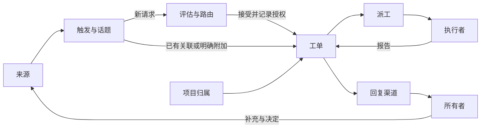

# 001 领域模型

本章承接 [000 理念](000-philosophy.md)，沿用上游 [001 Domain model](https://github.com/deepseek-ai/dsh-superagent-prototype/blob/8c32a9dc5d72c033816c6a8110b37f40cf94fba4/docs/001-domain.md) 的五节结构。它整理已有概念，说明多项目和任务表如何接入，不另建一套任务模型。

依据包括本地 [领域核心](../vendor/dsh-core/src/model.ts)、[阶段定义](../vendor/dsh-core/src/stage.ts)，以及 OSA 已讨论的 [多项目管理](P4-MULTIPROJECT-PLAN.md) 和 [持续工作](p4/CONTINUOUS-WORK-REQUIREMENTS.md)。上游参考版本为 `8c32a9d`，本地核心版本仍为 `6337fc8`。旧文档与第一章或开发宪章冲突时，不沿用旧结论。

状态：2026-11-06，已确认项目按业务归属组织，可包含一个或多个仓库；单仓库任务沿用 dsh，跨仓库任务关联执行并共同交付。其余内容为整理稿，设计目标与已有实现分别注明。

## 流程

对应上游：Flow。

来源把消息转成带来源和身份的事件。新工作进入评估，接受后形成有授权的工单；明确属于已有工作的补充进入原工单。派工连接执行者，结果通过原渠道返回。

对应第一章的产品形态：

- 在项目下提出新任务：项目已知，程序校验身份，Router 判断是新工作还是已有工作的延续。
- 在任务内评论：工单已知，补充进入对应工作；执行者判断能否在原范围内处理，超出范围时交回 Router。
- 在全局聊天、飞书或 GitHub 提问：保留原消息和回复位置，依据明确引用或已有绑定定位；归属有歧义才询问。
- Agent 更新进度或回复结果：进入对应任务的记录，不因出现一条新消息就产生新授权或新任务。

任务评论是本地入口拟承载的消息形式。飞书群、GitHub 仓库和项目不要求一一对应，来源本身也不等于业务项目。

## 概念

对应上游：Concepts。

### 沿用上游的核心概念

产品界面的“任务”沿用 **Ticket／工单** 所表达的授权工作。单仓库任务直接对应工单；跨仓库工作保持共同的业务目标和整体结果，具体记录方式见本章的复用边界。用户不必另外维护一份任务清单和一份工单清单。

| 概念 | 定义 | 保留的规则 |
| --- | --- | --- |
| Source／来源 | 产生外部事件的入口 | 来源类型是接入方式，来源实例是具体配置；来源负责原生身份、监听范围、读取位置和回复地址 |
| Trigger／触发 | 一条有稳定编号的原始事件 | 保留原文和来源；同一事件重放不重复接单 |
| Thread／话题 | 来源定义的一组有序事件 | 同一话题同一时刻只进行一个评估；一个话题可以包含多件工作 |
| Correlation／关联 | 多个话题之间的背景联系 | 帮助理解上下文，不据此自动派送请求 |
| Channel／回复渠道 | 结果回到哪里 | 保留准确入口和话题；关联多个渠道不表示每条消息都要广播 |
| Policy／策略 | 谁能发起工作、适用什么准入规则 | 规则及版本由程序管理，外部文本不能自行改变规则 |
| Eval／评估 | 判断一批事件如何处理 | 程序检查资格，Router 理解请求并路由；技术方案属于执行者 |
| Decision／决定 | 一次路由判断及其依据 | 保存接受、停止、忽略或评估未完成的原因；附加已有工作也保留路由依据 |
| Mandate／授权 | 工作为什么可以做、允许做到哪里 | 来自所有者请求和适用规则；Router 的总结、背景消息和 Agent 回复不能增权 |
| Ticket／工单 | 一件有授权、可持续处理的工作 | 保存输入、派工、渠道和报告；业务状态独立于窗口状态 |
| Assignment／派工 | 工单与一次执行安排的绑定 | 一个工单可经历多次派工；新执行者应接上原目标和成果 |
| Subscription／订阅 | 工单与话题的关系 | 后续讨论进入相关工单；收到信息不等于获得额外授权；仅供背景的话题不自动恢复工作 |
| Input／输入 | 某张工单需要读取的消息或背景 | 记录归属和处理情况；投递、读取和处理分别说明 |
| Report／报告 | 执行者对进展、结果或阻碍的说明 | 保留原话和证据；不能用一次完成通知代替业务交付 |
| Attention／待决事项 | 执行者向所有者提出的具体问题 | 明确问题及相关请求，不从一段自由文本猜测是否需要人行动 |

来源保存读取位置，话题保存订阅和评估记录，工单保存输入、派工及报告。这样，换 Router 或执行窗口时，不必依赖旧会话的记忆重新拼接工作。

所有者通过各来源的原生账号识别。第一版不建立团队、成员、角色和组织层级；同一个人的不同账号分别核验。

### 项目与仓库

**项目按业务归属组织，一个项目可以包含一个或多个代码仓库。** 单仓库是默认的简单情况，不是硬性边界。不增加必备的“组件”层级。

| 概念 | 定义 | 与工作的关系 |
| --- | --- | --- |
| Project／项目 | 所有者在业务上持续推进和管理的对象 | 包含任务和相关仓库；重命名不改变身份与任务归属 |
| Repository／仓库 | 代码的存放和版本管理边界 | 一个项目可有多个仓库；分支、worktree 和窗口不因此成为新项目 |
| 任务 | 希望完成的一项结果 | 可以涉及一个或多个仓库；换执行者不改变原目标 |
| 执行位置 | 仓库在具体机器上的目录、分支或工作区 | 作为执行信息记录，不要求所有者先维护额外业务层级 |

例如，“客服系统”包含服务端、管理台和日报三个仓库：

- “修复日报日期显示”只涉及日报仓库，沿用 dsh 的单仓库任务方式。
- “增加客服标签，并在管理台显示”涉及服务端和管理台，需要协调接口依赖，并验证两边配合后的结果。

跨仓库工作明确涉及的仓库和授权范围，由 Executor 决定如何拆分、并行和交接。各部分进展关联回同一业务目标，最后报告整体结果；各仓库分别提交或合并，不自动等于业务需求完成。Router 只转交目标和定位信息，不制定实施步骤。

代码依赖不自动决定项目归属。两个业务使用同一工具库，可以保留各自项目，记录依赖，不必因此合成一个项目。

旧版 OSA 已有 `Component`、`Location`、`TicketTarget` 和 `Goal` 等记录，见 [Projects](../src/projects.ts)。先用现有项目归属和任务记录满足具体工作；只有一件事确实需要跨工单关联时才使用 Goal，不要求为每件任务先建立全部层级。工程备忘录保留有来源的事实，交接保留成果和下一步，均不要求单独建设通用知识系统。

已明确的项目和位置信息由系统复用，不要求所有者每次填完内部字段才能表达需求。

### 工单、执行者与窗口

Executor 是执行工作的角色，Session 是承载一次对话的运行上下文，窗口是访问它的界面，目录是文件所在位置。它们都不等于工单。

一张工单有明确的负责执行者，该执行者可以组织多个子智能体。接替通过派工和交接表达；临时子任务使用 Orca 原生能力，不把每个子窗口都变成一张业务工单。

OSA 的 Ticket 与 Orca 的 Task 也不混用：前者表示授权工作，后者表示原生编排任务。二者通过执行记录关联。

关闭窗口不结束业务，业务完成不直接删除目录。保留窗口、执行结束、释放容量和目录回收分别记录。

第一章要求直接打开的已有窗口也能关联任务。这个关系属于产品目标；本章不声称现有 OSA 已能自动识别和接管所有窗口。关联需说明具体工作和执行身份，并保留原授权。

### 对话与消息归属

任务内讨论、飞书话题、GitHub Issue／PR 都可以提供 Thread 和 Channel。一个工单可关联多个话题；一个项目群也可以包含多个工单。

不能把整个项目群或全局聊天当成唯一任务。给某件事的补充应进入那件事；仅有背景联系的消息不得变成对其他执行者的命令。

新请求保留 Trigger，进入工单后形成 Input。输入已投递，不代表执行者已读；已读，不代表已经处理。当前 OSA 的 [输入处理记录](../src/app.ts) 也明确区分这些事实。

工作超出当前工单或目标位置不对时，执行者说明原因并交回。Router 根据原请求重新定位，不改写成自己设计的解决方案。

### 状态由谁确认

| 事实 | 依据 |
| --- | --- |
| 要什么、允许做什么、是否停止 | 所有者原始消息与明确决定；程序记录和校验 |
| 交给了谁、消息去了哪里 | 派工和投递记录 |
| 做了什么、还有什么问题 | 执行者报告、输入处理说明及成果证据 |
| 是否需要所有者回答 | 明确的待决事项及其是否已解决 |
| 进程是否运行、窗口是否保留 | Orca 原生记录与现场观察，包含观察时间 |
| 任务处于哪个阶段、是否结束 | 程序根据已记录事实和交付规则计算；Router 转达 |

业务状态、输入状态和执行状态分别保留。待人工不等于进程必须占着槽位；进程退出不等于目标完成。Router 不能把“已入队”解释成“正在做”。

沿用上游的报告类型和阶段分类，不为界面再维护一份相互独立的状态。“waiting”说明正在等待，并不自动等于需要所有者决定；完成是否需要合并 PR，按该任务实际交付规则判断，不新增每单必须人工确认的步骤。

## 不采用的概念

对应上游：Rejected concepts。

| 不采用 | 原因 |
| --- | --- |
| 为个人工具建立团队成员和组织权限树 | 当前只有一个所有者，各来源的身份与授权规则已能表达需要 |
| 让评估器自己创建延时任务 | 持续观察由来源负责，执行等待由执行者和 Orca 负责 |
| 给评估新增“等待业务完成”“授权已撤销”等状态 | 评估负责路由决定，业务生命周期属于工单 |
| 一个话题只能有一个工单 | 同一群聊或 Issue 可能讨论多件事 |
| 每条后续评论都重新接单 | 已有订阅和明确归属即可送给原工单；附加关系不等于新工作 |
| 对每条订阅消息重新授予权限 | 订阅传递信息，行动仍受任务授权约束 |
| 仅凭关联或关键词相似自动路由 | 背景相关不能证明同一工作或相同授权 |
| 用窗口、Session 或 Orca Task 代替业务工单 | 业务目标需要跨执行尝试保留 |
| 执行者把自己的失败报告说成所有者叫停 | 失败和撤销授权是不同事实 |
| 策略变更就统一取消全部在途工作 | 先记录影响；具体授权处理在授权章说明 |
| 一次受阻就封死后续交互 | 必须保留人工补充、解释和恢复的路径；具体恢复服从已有授权 |
| 从报告措辞猜测待人工事项 | 明确的问题和回答关系更可核对 |
| 每项目新增一层 Router 或完整服务实例 | 第一章已选择一个跨项目 Router；上下文隔离不自动要求部署隔离 |
| 强制一个业务项目只能有一个仓库 | 多个仓库可能共同实现同一业务；单仓库只是简单默认 |
| 因代码依赖自动合并项目，或强制增加组件层 | 依赖可以直接记录，项目归属由实际业务决定 |
| 让用户同时维护 todo、工单和窗口进度三套记录 | 任务表是已有工作记录的视图，状态应由实际工作更新 |

以上是领域边界，不是新一轮可靠性机制的实施清单。已回退的自动接续等方案不在此恢复。

## 哪些可以复用

对应上游：What is reusable。

| 部分 | 沿用或适配方式 | 当前边界 |
| --- | --- | --- |
| 工单、派工、订阅及报告 | 复用 `vendor/dsh-core` 的概念和接口 | 不修改 vendor；上游新版本文档不等于本地已升级 |
| 项目与仓库归属 | 参考 OSA 旧版的项目和目标绑定 | 现有代码通过组件关联仓库；新版不把组件设为必备产品层级 |
| 跨仓库共同目标 | 优先核对已有 Goal、工单关联和 Orca 执行能力 | 当前 TicketTarget 固定一个目标位置；多仓任务如何映射这些记录尚未确定，不声称已支持完整共同交付 |
| 工作线、备忘录与交接 | 复用 OSA 已有记录 | 不因新 UI 再建一套记忆系统 |
| GitHub、飞书来源 | 沿用现有接收和回复适配 | 来源配置与项目归属分开，不默认一项目一群 |
| 本地项目任务评论 | 映射为来源事件、话题和回复渠道 | 产品形态已确定，界面与接入实现尚待验证 |
| Executor | 将领域派工映射到 Orca 的执行能力 | 模型类型、窗口形态及子智能体由执行适配承担 |
| 已有窗口关联 | 关联任务、会话和已有成果 | 接入范围、具体操作与识别能力尚未验收 |

有一处现有差异需要明确：上游把 Mandate 定义为不可变，扩大范围需要另建工单；当前 OSA 的 `route attach` 会保存所有者补充和修订记录，并更新工单范围文本。所有者已在 [002 授权](002-authorization.md) 确认沿用上游：范围内补充作为 Input 处理，范围外请求交回并重新接单。旧代码尚未调整，不能当作新版规则。

旧版多项目方案中“Router 管实施依赖”等表述，不再作为 Router 的职责依据。当前职责以第一章和开发宪章为准：Router 定位与路由，Executor 规划与实施。

## 术语表

对应上游：Glossary。

| 英文 | 本文用语 | 简要含义 |
| --- | --- | --- |
| Project | 项目 | 业务工作的归属 |
| Repository | 仓库 | 代码的存放和版本管理边界；一个项目可包含多个 |
| Component | 组件 | 旧版 OSA 的工程绑定记录，不是新版必备业务层级 |
| Location | 执行位置 | 工程在具体机器上的位置 |
| Goal | 工作线 | 关联多个工单的持续目标 |
| Router / Main Session | 路由者／路由会话 | 处理请求归属、路由与反馈 |
| Executor / Executor Session | 执行者／执行会话 | 负责具体工作及其对话上下文 |
| Agent | 智能体 | 执行某个角色的模型实例 |
| Source / Source kind / Source instance | 来源／来源类型／来源实例 | 事件入口、接入方式与具体配置 |
| Trigger / Thread | 触发／话题 | 原始事件及其讨论上下文 |
| Correlation / Subscription | 关联／订阅 | 背景联系／消息投递关系 |
| Channel | 回复渠道 | 回复的具体去处 |
| Policy / Policy version | 策略／策略版本 | 准入规则及其版本 |
| Eval / Gate / Assessment | 评估／准入／研判 | 路由判断、程序资格检查、模型理解 |
| Decision | 决定 | 路由结果及原因 |
| Mandate / Scope / Strength | 授权／范围／强度 | 工作依据、允许做什么、授权依据的类型 |
| Ticket | 工单 | 授权工作的记录；单仓任务直接对应，多仓任务的记录映射另行明确 |
| Assignment | 派工 | 一次执行安排 |
| Input / Report / Attention | 输入／报告／待决事项 | 待处理信息、执行说明、需要人回答的问题 |
| Fan-out / Disposition | 扇出／去向 | 订阅分发及事件如何被处理的记录 |
| Execution environment | 执行环境 | 执行所需的位置与运行条件 |
| Session / Workspace | 会话／工作区 | 对话运行上下文／文件与工具环境 |

沿用的状态值：

| 对象 | 值 |
| --- | --- |
| 路由决定 | `accept` 接单、`stop` 停止、`ignore` 忽略、`unavailable` 评估未完成 |
| 授权强度 | `explicit` 明确、`inferred` 推断；OSA 当前以所有者明确请求为基础 |
| 派工 | `pending` 待启动、`running` 执行中、`ended` 已结束 |
| 报告 | `progress` 进展、`waiting` 等待、`ready` 就绪、`blocked` 受阻、`failed` 失败、`dropped` 无需继续 |
| 工单结束结果 | `completed` 完成、`merged` 已合并、`closed` 已关闭、`dropped` 无需处理、`stopped` 已停止 |

面向所有者时使用自然语言解释这些状态，并指出原因和下一步。内部名词用于保证代码、文档和界面表达同一件事，不要求使用者学习全部术语。
