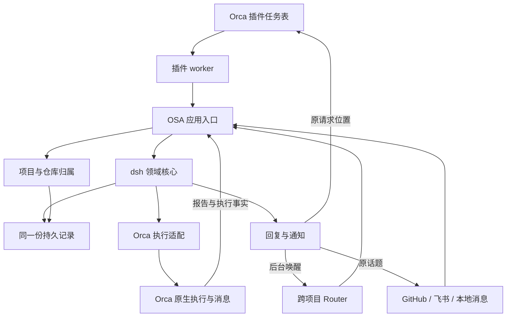

# 007 架构

本章承接 [006 部署](006-deployment.md)，按上游 [007 Architecture](https://github.com/deepseek-ai/dsh-superagent-prototype/blob/8c32a9dc5d72c033816c6a8110b37f40cf94fba4/docs/007-architecture.md) 的全部小节顺序，说明职责、依赖、状态及接口如何对应 OSA。

状态：2026-11-07，设计与现状对照稿。沿用 dsh 的领域核心；OSA 补充多项目归属、本地任务入口和 Orca 适配。部署采用上一章的首选方案，具体插件接入仍待验证。原版文档基于 `8c32a9d`，本地 vendor 基于 `6337fc8`，不假定两个版本的宿主实现完全相同。

## 核心类与连接代码

对应上游：Core classes and glue。

下文按原版职责对照现有代码，不是要求实现同样数量的类、接口和目录。先把实际请求在现有函数中写清楚；单次使用的逻辑就近内联，已有公共能力直接复用。

图中的插件入口是待实现部分。现有后端可以作为适配基础，但原有固定模型、审查门禁和收尾限制不自动成为新版设计。

### Runtime：运行入口

对应上游：Runtime。

原版 Runtime 组装存储、来源、执行器、工具和面板接口，管理启停，不承担业务判断。OSA 对应职责目前分布在 `bin/osa.ts`、`App` 及服务脚本中。

启动时核对状态目录与配置，连接 Orca，加载来源和当前 Router 绑定，再处理持久待办。停止时停止接收新的服务请求并完成必要记录；重启 OSA 不推断 Orca 执行者已经退出。

插件调用这套服务，不再启动另一个 Engine 或另写一份业务库。每项目独立服务不是多项目管理的前提。

### Engine：领域流程

对应上游：Engine。

复用 [Engine](../vendor/dsh-core/src/engine.ts) 及 [ports](../vendor/dsh-core/src/ports.ts)。它通过存储、策略、来源范围、评估者、执行器和发件箱接口管理工作，不直接调用 Orca、GitHub 或飞书。

| 原版内部部分 | 责任 |
| --- | --- |
| Intake | 保存事件、判断去向、订阅分发与待评估请求 |
| Evals | 批量评估、路由决定、超时和交回 |
| Tickets | 授权工单、订阅、接续、停止与结束 |
| Assignments | 执行开始、输入送达、读取和报告 |
| Replies | 按请求关系生成确认、答复、结果和待决消息 |

领域命令在事务内变更记录。外部工作先入队，事务提交后再由适配器执行；不能在事务回滚后留下一个没有记录的新 worker。

主要事实通过已有方法回写，例如 `assignmentStarted`、`inputsDelivered`、`inputsRead`、`deliveryFailed` 和 `report`。停止请求与已经停止的事实分别记录，不能把调用成功当成进程已经退出。

**现状差异：** 旧 `App.route attach` 直接追加 `mandate.scope`。新版按授权章回到范围内附加、范围外交回的规则，不用界面或适配层改写核心授权来绕过它。

### Model：领域对象

对应上游：Model。

复用 `model.ts`、`stage.ts`、`reasons.ts` 的工单、输入、派工、报告及原因定义。每种事实保留一份记录，页面和摘要从记录生成。

多项目归属由 OSA 维护，工单关联业务项目和涉及的仓库。分支、工作目录、Session、原生 Task／Dispatch 是执行定位信息，不变成额外业务目标。

源消息的 `meta` 保存来源特有事实，核心不解释其中的 GitHub 或飞书字段。界面需要更多信息时，优先读取已有关系，不为了一个展示标签增加一套独立状态机。

### Policy：准入策略

对应上游：Policy。

复用已有 `gate`、`revalidate`、`admitsInferred` 处理准入和恢复，不再在插件、App、辅助函数和执行适配里各写一套相同判断。外部输入在接收边界完成必要校验，核心按已确定的类型执行业务规则。

OSA 第一版只接受所有者的明确工作要求，主动接单不默认开启。不同项目复用同一机制，适用来源和约定作为数据保存；多仓库不新增特殊权限。

现有 `App` 提供 `owner-only-v1` 策略，恢复检查主要核对所有者身份。不能把这一简化实现当成完整的策略版本和多入口恢复能力；也不为未启用的团队功能补齐整套权限树。

### Store：持久记录

对应上游：Store。

[Store](../src/store.ts) 实现核心的同步存储接口，使用 SQLite 和事务。工单、项目、报告与待办共用这份持久记录，面板不直接写数据库。

读接口读取事实，写操作经过相应业务入口。插件缓存、页面筛选和摘要可以重建，不能覆盖原始请求、执行报告或投递回执。

原版有专门的索引、分页和版本表；当前 OSA 用按类型保存 JSON 的 `records` 表，部分读取按类型扫描。现阶段保留实际可用的存储方式，不为复制表名而迁移数据库；数据规模确实造成问题时再针对查询改进。

### Effects：待执行动作

对应上游：Effects。

沿用“先持久记录，再执行”的原则，覆盖派工、输入投递、Router 唤醒和对外回复。记录动作身份、当前结果和失败原因，同一动作的重放沿用原身份。

旧 OSA 已有 `orca-job`、`orca-operation`、`router-wake` 和 `outbox` 等记录。它们分别适配不同外部接口，不必先重写成原版同名 Effects 框架。

明确未发生的临时失败可以重试；结果不明时查询原生回执。没有槽位是等待条件，不应伪装成执行失败。某个任务或来源的失败不阻断其他独立工作。

这些是业务请求与回执的处理，不是第二套进程调度器，也不扩展为已放弃的通用外部效果追踪系统。

### Sources：来源

对应上游：Sources。

来源负责四件事：把原消息转成 Trigger，说明监听范围，提供原始上下文，以及按 Channel 回复。Source 类型、具体接入配置和业务项目分别表达。

原版通过 SourceRegistry 注册来源；OSA 当前通过 `GitHub`、`Feishu` 和本地 `intake` 接入，尚无等价的通用注册框架。新增本地任务评论时，先复用核心端口及当前适配模式，不为一个入口先造插件平台。

多仓库的同号 Issue、多群中的同号消息必须可以区分。稳定身份包含必要的来源范围，不使用可能重命名的项目标题作为唯一身份。

新来源与既有来源经过同一准入、工单和回复规则。面板按钮不能绕过这些规则直接把任务标成完成。

### DshExecutor：执行适配

对应上游：DshExecutor。

原版 DshExecutor 调用 DSH 会话和作业。OSA 对应 [OrcaExecutor](../src/orca.ts)，实现同一组核心端口：

| 端口 | 应完成的事 |
| --- | --- |
| `start` | 记录待执行安排，通过 Orca 启动或关联实际执行者，回报真实启动结果 |
| `deliver` | 将未处理输入交给正确执行者，区分投递、读取和处理结果 |
| `stop` | 对明确执行身份请求停止，记录原生结果，不将未知状态伪装成已退出 |

适配层保留工单、Assignment 与原生 Task／Dispatch 的关联。一个工单的多仓协作由负责执行者组织，不把每个子窗口自动变成新业务工单。

重试、收尾、已完成执行的后续消息，优先使用原生能力并按第三章核对语义。旧 OSA 的 `finished`、子窗口必须全部 `released` 等条件是待修正实现，不是领域要求。

### MasterAssessor：评估接入

对应上游：MasterAssessor。

原版负责把候选及上下文交给主 Session，并收回判断。OSA 当前把 Candidate 持久保存，通过 Router 读取和原生唤醒连接模型。

提供原始请求、相关话题、已有工单和适用策略即可。Router 可跨项目找到对应工作，不能在候选摘要里预先植入实施计划。

第一版不启用推断式主动接单，无需为此复制原版所有主动评估工具。以后有真实需要时，仍通过原准入和评估端口扩展。

### Settings：配置

对应上游：Settings。

沿用按来源、策略、执行等责任划分配置，并记录实际生效状态。项目仓库是配置与关联数据，不为每个项目复制服务。

现有配置散布在启动参数、状态记录和托管配置中。新面板应读取和操作相应权威入口，不保存一套只影响界面、与服务互不一致的值。

面板中所有者的配置操作与 Router 的工具权限区分。当前许多管理命令要求 Router 租约；这不能直接作为新面板的权限设计，尤其不能让每次打开面板都接管 Router。

### Prompts：提示词

对应上游：Prompts。

按第四章维护角色、沟通、范围、交付、来源与环境说明。现有 skill、提示词文件和源码版本先满足使用；不因原版有配置历史、模板覆盖和热更新，就把它们全部列为待建模块。

提示词正文、工具实际参数和程序校验应一致。删除“两轮即停”的说明而代码仍拒绝继续，不算完成适配；同样不能只改代码却让旧说明继续要求停工。

所有者的真实消息以工作输入保留，不拼接成由 Router 自行扩写的基础规则。运行会话何时读到新版，按宿主实际能力说明。

### Sessions：会话

对应上游：Sessions。

原版直接控制 DSH 会话、工具和逐请求提示词。OSA 通过 Orca 已有会话与消息能力完成创建、关联、通知和读取，不能假定拥有同等宿主钩子。

Router 的逻辑身份与某个会话窗口分别记录。更换绑定后通知发到当前会话，未处理工作仍留在 OSA；不能因为换窗口就丢掉业务记录。

已有窗口接入要核对真实会话、任务与原请求的关系。能列出窗口不等于已获得所有人工输入；无法覆盖的路径明确说明，不读写 Orca 私有库或修改宿主来伪装支持。

### Glue：连接代码

对应上游：Glue。

连接代码在对应边界解析外部请求或回执，转成已有类型后调用业务代码。已经转换过的内部对象不再逐层解析、校验或包装。

当前主要在 `bin/osa.ts` 和 `App`。插件入口是新增适配面：用户操作进入服务，结果由服务回给面板。实现时按实际需要拆分文件，不按原版类名先搭一套空框架。

## 依赖规则

对应上游：Dependency rules。

本节按当前个人工具的需要约束实现，不按原版类图补框架。

**入口单次校验。** 校验只做本次使用所需的字段、来源身份和目标关系，成功后以明确类型传入内部。边界如下：

| 外部输入 | 校验负责位置 | 内部如何使用 |
| --- | --- | --- |
| 插件／CLI 发来的本机请求 | OSA 服务接收入口 | 插件转发层不复制业务校验；App 和核心使用已解析类型 |
| GitHub、飞书等原始响应 | 对应来源适配入口 | 转成 Trigger 后不再用同一 schema 逐层解析 |
| Orca 命令的原始响应 | 调用它的原生适配入口 | 转成所需结果类型，后续复用；不在每个调用者重新查身份 |
| 配置文件 | 加载或实际变更入口 | 内部使用已加载配置，不在普通读取时重复验证 |

每次新外部响应属于新的输入；同一个已解析对象在函数间传递不是新边界。工单是否已停止等业务前提，在负责该状态变更的位置判断一次；这不构成在每层重查字段和账号的理由。

**不提前抽象。** 单次逻辑内联，不为表中的每个职责建立 helper、DTO 包装、基类或注册器。只有已经出现重复，或当前函数确实混合了难以理解的独立职责，才作最小抽取；一个函数能清楚表达时保持一个函数。

**只在能处理的地方捕获错误。** 当前层能够恢复、补充必要上下文或释放自己持有的资源时才使用 `try/catch`。其余错误交给已有入口统一报告，不逐层捕获后换个字符串再抛出，也不吞掉失败返回伪成功。

其余依赖关系保持直接：

- 核心不依赖 Orca、插件 UI、GitHub 或飞书，不在 vendor 中增加宿主代码。
- 来源通过核心接口提交事件，执行适配通过核心接口回报事实；它们不直接改写 Mandate。
- 面板通过服务读写，不直接打开状态库或控制未知进程。
- 请求与事实分开命名、分开记录。请求停止可能失败，“已停止”必须有对应依据。
- 普通查询不抢占 Router，不改变任务状态。
- 项目范围和来源范围传到实际操作处，不能在中途退回启动目录或默认仓库。

| 状态 | 负责维护的部分 |
| --- | --- |
| Trigger、Thread、Decision、Ticket、Assignment | 领域核心 |
| 来源读取位置及来源元数据 | 对应来源适配 |
| 项目、仓库和目标关系 | OSA 项目管理部分 |
| 原生执行关联及观察记录 | Orca 适配；真实执行事实由 Orca 提供 |
| 待发送消息和发送结果 | 发件箱及其来源发送适配 |
| 配置和当前提示词来源 | 相应配置入口；使用已有文件或宿主记录 |
| 任务列表和摘要 | 从上述记录生成的只读视图 |

“一个负责方”不要求每类记录都有一个独立进程或新类。它要求变更走清楚的入口，避免多个地方各写一套互相矛盾的事实。

### 来源特有依赖

对应上游：Source-specific dependencies。

原版并非完全通用：PR 归属和结束规则、飞书字数及回复地址、账号检查仍有来源特有代码。OSA 也可以保留必要的具体适配，不为形式上的统一增加抽象。

多项目需要核对这些实际边界：GitHub 的仓库与账号、飞书的群与话题、本地任务的项目与讨论、回复渠道的目标。共用框架不意味着共用一个模糊的默认地址。

## 模块

对应上游：Modules。

下表是当前代码索引，不是要求继续保留每个旧规则。插件面板尚未实现，不给它编造已有文件名。

| 当前文件 | 责任与适配重点 |
| --- | --- |
| `vendor/dsh-core/src/` | 原样保留领域核心、端口与阶段定义 |
| `src/app.ts` | 命令与准入、工单操作、报告接受；纠正范围字段改写等差异 |
| `src/store.ts` | SQLite、领域存储接口及现有派生通知 |
| `src/projects.ts` | 项目归属、目标位置、工作线、备忘录与交接；旧组件层不自动成为 UI 层级 |
| `src/orca.ts` | 执行安排、投递、观察和收尾适配 |
| `src/router.ts` | Router 绑定与后台唤醒 |
| `src/orca-session.ts` | 已有会话通信及操作结果核对 |
| `src/github.ts` | GitHub 接收、PR 关联和发件箱发送 |
| `src/feishu.ts` | 飞书身份、话题读取和回复 |
| `src/review.ts`、`src/publish.ts` | 旧审查与发布逻辑；按已确认的原版交付规则重新核对 |
| `src/cleanup.ts` | 既有工作区检查与清理；不等于任务结束必须删除目录 |
| `src/watchdog.ts` | 已有原生异常事件导入，不代替业务授权或执行结果 |
| `bin/osa.ts` | CLI、本机服务接口、运行组装与循环 |
| `bin/osa-router-chat.ts`、`bin/osa-router-takeover.ts` | Router 会话创建与显式接替入口 |
| `bin/osa-watchdog.ts` | 原生异常事件的适配入口 |
| `scripts/osa-service.mjs`、`scripts/osa-supervisor.mjs` | 本机服务启停和托管；人工停止语义需适配 |
| `scripts/install-watchdog-queue.mjs` | 既有事件队列接入脚本，不因此要求新安装增加更多监督进程 |

## 测试

对应上游：Tests。

沿用原版的分层验证：核心规则、实际适配、界面交互和完整工作循环各有依据。一次模拟成功不能证明真实 Agent 已正确续接。

| 当前测试 | 覆盖的责任 |
| --- | --- |
| `vendor/dsh-core/tests/core-engine.spec.ts`、`vendor/dsh-core/tests/stage.spec.ts` | 上游领域流程与阶段 |
| `tests/app.test.ts`、`tests/store.test.ts`、`tests/projects.test.ts` | 应用操作、持久记录和项目关系 |
| `tests/orca.test.ts`、`tests/orca-session.test.ts`、`tests/router.test.ts` | 原生执行与会话适配、Router 唤醒 |
| `tests/github.test.ts`、`tests/feishu.test.ts` | 来源接收和回复 |
| `tests/report.test.ts`、`tests/review.test.ts`、`tests/publish.test.ts` | 报告及旧版审查、发布规则 |
| `tests/cleanup.test.ts`、`tests/watchdog.test.ts` | 资源处理与异常事件 |
| `tests/cli.test.ts`、`tests/service.test.ts`、`tests/supervisor.test.js` | 命令、启停和托管 |

旧测试可能恰好锁定了要修正的行为，例如两轮即停。应依据已确认规则和真实反例调整，不能以“测试要求如此”保留不合适的产品行为。

新增任务评论和插件时，至少验证原消息入库、项目归属、Router 唤醒、任务内补充、结果回传和草稿保护。涉及多仓执行时验证整体交付，涉及重启时验证原执行不会重复启动。细节按实际改动补最小有意义的回归，不为假设场景扩展可靠性架构。

## 持久化

对应上游：Persistence。

当前 OSA 使用 `<state>/state.db`，由 Store 打开；`records` 表以 `kind`、`id` 标识 JSON 记录。使用 WAL 和事务。原版拆分多张表及索引，OSA 不必为表结构相同而重写存储。

| 记录类别 | 当前示例 | 含义 |
| --- | --- | --- |
| 领域事实 | `core.trigger`、`core.disposition`、`core.thread`、`core.decision`、`core.ticket` | 原消息、处理去向和授权工作 |
| 项目与交接 | `project`、`component`、`location`、`ticket-target`、`goal`、`knowledge`、`handoff` | 旧版归属与工程记录，按已确认产品模型使用或迁移 |
| 执行与操作 | `orca-assignment`、`execution`、`execution-attempt`、`orca-job`、`orca-operation` | 业务与原生执行的映射及待处理动作 |
| 消息与报告 | `outbox`、`orca-delivery`、`input-resolution`、`report-receipt` | 发送、输入处理和领域接受结果 |
| Router 与配置 | `router`、`router-wake`、`config`、`notice` | 当前接入、配置和待处理异常 |

这些记录不全是新版必须保留的独立概念。迁移时保留原始请求、授权、成果与回执，不清空数据库来制造“无历史问题”的假象。

新旧格式兼容需明确验证。备份使用 SQLite 一致性备份，不能遗漏 WAL。插件显示缓存不参与业务事务；任务历史也不因面板关闭、列表隐藏或临时窗口释放而删除。

只记录工作所需信息，不保存凭据值或为方便检索复制全部私人聊天。历史保留与清理按实际需求处理，不在本章引入通用归档系统。

## 面向模型的接口

对应上游：Model-facing interfaces。

### Router 工具

对应上游：Main Session tools。

保留原版“读取、路由、转达”的权限边界，不因跨项目就授予实现或批准权。

| 原版用途 | 当前 OSA 对应 | 新版边界 |
| --- | --- | --- |
| 读取候选和工单 | `router wait`、`status` 及项目查询 | 先提供相关事实，后台事件到来后读取；不维持模型轮询 |
| 接单、关联、停止、忽略 | `route accept/attach/stop/ignore` | 使用原消息，范围外重新接单，不更新原 Mandate |
| 恢复已有工作 | `route retry` | 经当前授权与原生状态确认，不制造新目标绕过失败限制 |
| 回答与转达 | `reply`、`router ack` | 回正确入口，处理后确认；普通进展不逐条打扰所有者 |
| 配置与提示词 | 旧代码只有部分管理命令 | 所有者明确配置行为才变更；未实现的原版工具不宣称可调用 |

原版支持批量路由和更丰富的读取工具，当前 CLI 不完全对应。保留所需语义，不要求一比一复制命令名和参数。

### 预设与等待限制

对应上游：Presets and wait limits。

原版通过 Router 预设限制阻塞等待，并自动投递事件。OSA 保留“无事时结束轮次，事件到来再处理”的行为，具体由 Orca 后台消息实现。

不同 Agent 的 shell 超时、后台作业和系统提示加载方式不同。不能仅凭一段提示词宣称已具备 DSH 的五秒后台切换或工具限制，也不为复制这些限制改动 Orca 本体。

### Executor 工具

对应上游：Executor tools。

| 原版工具用途 | 当前 OSA 对应 |
| --- | --- |
| 读取当前工作及来源 | `read` |
| 向请求者确认接手 | `acknowledge`；不要与确认输入已读的 `ack` 混淆 |
| 报告进展、结果或问题 | `report` |
| 解除错误话题关联 | `thread unrelated` |
| 订阅相关背景 | `thread follow` |
| 交回范围外请求 | `handback` |

原生 `worker_done` 结算执行尝试，不代替领域报告。模型使用工具后，以返回的真实结果描述状态；`queued` 不等于业务已经接受。

旧版额外的 `review`、`pr publish` 等接口需按原版交付规则评估，不因为接口已经存在就把它们变成所有任务的必经步骤。

### 返回结构与评估上下文

对应上游：Result shapes and assessment context。

沿用原版对结果的区分：成功返回实际对象或决定，拒绝返回具体原因，结果未知明确保留未知。批量处理时各项独立表达，不能因为一项成功就宣布整批完成。

Router 读取原始请求、相关话题、已有工作、项目定位和策略依据；Executor 读取自己的目标、输入、相关仓库与交接。优先给足以判断的内容，截断后提供可读取的原文位置，不把所有项目的历史一次塞进模型。

当前 `Request` 和 `{ok, result/error}` 是 OSA 本机接口形状，原版 API 的字段名与状态码不能直接当作已经支持。新增 UI 请求应复用相同业务入口，错误表达保持一致。

### 可读资源

对应上游：Read resources。

| 资源 | 应可读取的内容 |
| --- | --- |
| 项目与任务 | 归属、目标、阶段、相关仓库和当前负责执行者 |
| 原消息与话题 | 原文、来源、回复关系及处理去向 |
| 路由决定与授权 | 依据、范围、停止与重新接单记录 |
| 派工、输入和报告 | 当前与历史尝试、待处理补充、结果及证据 |
| 配置与提示词 | 实际配置、来源及已核实的生效版本 |
| 原生执行 | 对应 Orca 记录与观察时间，不假造宿主未提供的状态 |

任务表、全局聊天和 Router 从同一组事实读取。查询范围按角色和项目确定，普通查询不产生新开发工单。资源需要分页时，页与原记录之间可继续追溯；不把摘要当成唯一事实。

### 投递到会话的消息

对应上游：Messages delivered to Sessions。

沿用原版的消息类别与责任：

| 接收方 | 内容 | 应有行为 |
| --- | --- | --- |
| Router | 新候选、交回请求 | 读取原话与定位依据并路由 |
| Router | 已归执行者的人工补充通知 | 知道它的去向，不再重复派发 |
| Router | 可交付结果或明确问题 | 回到原请求位置，保留原报告和必要下一步 |
| Executor | 派工、原始请求和后续输入 | 按范围处理，报告结果或交回 |

原版把普通进度和部分配置、结束通知留在记录中，不为每次变化唤醒主 Session。OSA 同样选择需要动作的事件；持久待办与原生唤醒提示分别确认，不能把提示当作所有者的新指令。

旧 `Store.routerNotices()` 会持续生成部分进度及等待提醒。这是现状，不能成为原版“少打扰”的替代规则。新版应核对每条通知是否真需要 Router 或所有者行动。

### 仅供界面的操作

对应上游：Panel-only actions。

原版将部分操作留给人，例如重新检查配置、忽略已知异常，以及把仍由执行者负责的输入交回评估。OSA 也要保留人和 Router 的操作边界。

插件中的人工操作应使用明确的界面管理入口，不向 Router 暴露一个可以代替人执行所有操作的通用按钮接口。当前接口中 `status` 等命令也要求租约；界面读取需要适配，不能为查看任务而抢占 Router。

这是角色与操作语义的区分，不建立新的同用户进程防冒充机制。尚未实现的面板操作按能力缺口说明。

## 配置重载

对应上游：Configuration reload。

原版依靠 DSH 配置和会话机制实现多项热更新。OSA 先按实际需要采用现有重载或重启方式，说明生效时机，不建设一套通用热更新、配置版本合并或并发保存框架。

状态目录或账号身份变更不能静默移动在途工作。需要重启时按部署章保留状态并核对原执行；保存配置、服务已加载和已有会话已使用分别表达。

## 使用真实数据审查改动

对应上游：Reviewing a change against real data。

沿用原版的隔离回放原则：从一致性备份复制状态，在独立目录读取；来源和外部动作使用只读或测试替身，避免向真实群发消息、重复派工或发布 PR。

旧 OSA 不能完整使用原版的暂停开关，因此不能只改一个配置值，就把复制的业务库接到真实 Orca 后称为安全回放。使用现有测试中的 Store、App 和替身端口构造可控检查，确认不会发出真实外部动作。

真实 Agent、插件和重启行为另做范围明确的试用验证。模拟通过与实际验证分别记录，不以理论竞态或未复现的问题阻断交付。

## 待验证问题

对应上游：Open questions。

产品方向已明确，剩下主要是实际接口是否足够，以及旧实现如何收敛：

| 问题 | 当前依据 | 验证应得到什么 |
| --- | --- | --- |
| 插件面板连接 OSA | Orca 有公开面板／worker 通信，OSA 有本机服务 | 提交、读取和回复走同一业务记录，关闭面板后不丢工作 |
| 原窗口的持续关联 | 原生可定位会话及部分消息，完整双向接入未验收 | 人工补充与结果能正确归属；不覆盖草稿或猜测授权 |
| 多仓库工单 | 核心工单可保留共同目标，旧目标与发布适配偏单仓 | 一个目标下多个仓库成果能共同交付，权限不因分仓扩张 |
| Router 事件与资源收尾 | 已有回执和原生唤醒；历史有漏唤醒与空占槽案例 | 后续要求持续被处理，真实资源状态与业务状态不混淆 |
| 配置、账号和交付默认值 | 旧代码与原版有明确差异 | 运行版本符合本系列约定，旧数据可追溯、不重复执行 |

以上是实际产品路径的验证，不要求枚举所有故障时序。风险处理分为：

| 情况 | 证据与概率 | 处理 |
| --- | --- | --- |
| 漏唤醒、临时错误永久缓存、保留窗口堵住后续输入 | 已有会话、记录和复现；能证明发生过，尚无发生率统计 | 在实际故障点修复并回归，不借题扩成通用恢复框架 |
| 多个客户端同时修改同一配置 | 当前没有实际反例，也无概率数据 | 不默认增加版本锁、自动合并和冲突恢复 |
| 要求任意停止、重试、升级交错下都绝不出错 | 无这类完整保证的个人使用需求；不能从隔离实验推导日常频率 | 不建设全时序协调、代际围栏或额外执行协议 |
| 同用户进程蓄意冒充另一角色 | 不在当前个人同用户工具的信任范围内 | 不据此新建凭证和隔离体系 |

要为尚未发生的低概率问题增加机制，先向所有者说明具体触发条件、概率或观测频率的依据、影响和最小改动代价，取得确认后再做。没有数据就写未知，不捏造百分比，也不先搭监控系统来证明需要另一套机制。

已有事务、真实输入校验、请求去重和必要错误处理继续使用；这些维护实际数据和工作流程，不等于新增理论防御。未解决的罕见可能性可以记录，不作为交付阻断条件。
